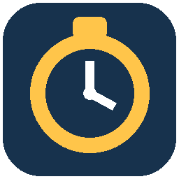
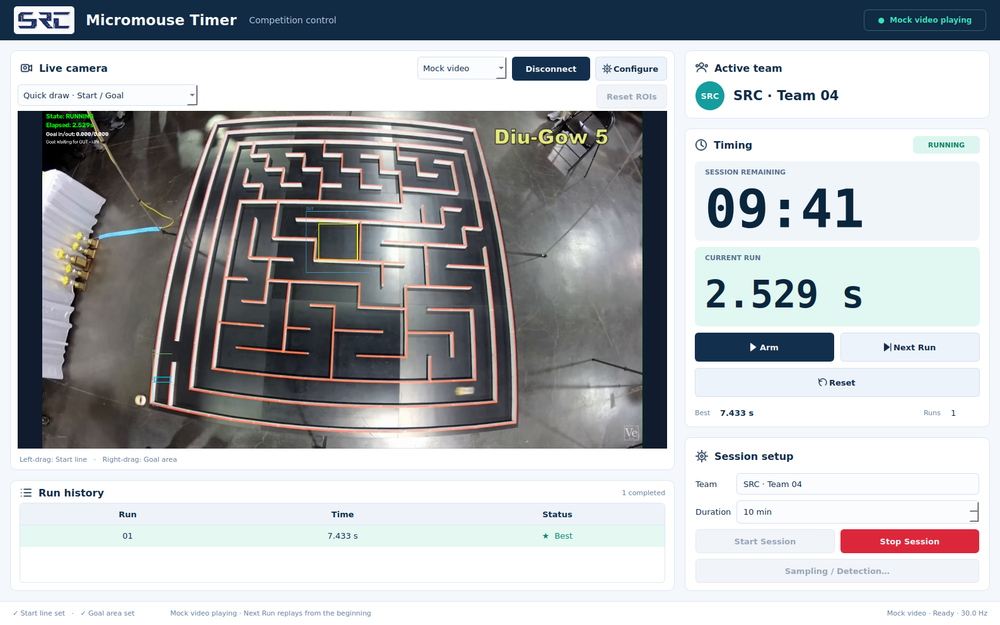

<p align="center">
  
</p>

<h1 align="center">Micromouse Timer</h1>

<p align="center">
  Ứng dụng desktop điều khiển phiên thi và đo thời gian chạy của robot Micromouse bằng camera.
  <br>
  SRC · CLB Sinh viên Nghiên cứu Khoa học · Trường Điện – Điện tử
</p>

<p align="center">
  <a href="docs/usage.md">Hướng dẫn sử dụng</a> ·
  <a href="docs/development.md">Phát triển</a> ·
  <a href="docs/packaging.md">Đóng gói Windows/Linux</a>
</p>



## Chức năng

- Nhận hình từ **USB camera**, **IP stream** hoặc **video mock** qua OpenCV.
- Đặt đường xuất phát, vùng đích và các vùng so sánh bằng thao tác kéo chuột.
- Nhận xuất phát theo thứ tự **A → B**, về đích theo **OUT → IN**; bù rung camera nhẹ bằng đặc trưng nền, không cần ArUco.
- Quản lý đội thi, thời lượng phiên, đồng hồ lượt chạy, lịch sử và lượt tốt nhất.
- Ghi CSV dự phòng trong phiên và xuất Excel khi kết thúc.
- Điều chỉnh chu kỳ lấy mẫu, thời gian xác nhận đích và thời hạn chuyển vùng.
- Giữ kích thước vùng video ổn định khi cập nhật đồng hồ, tên đội hoặc số lượt; popup và nút có phản hồi tương tác nhẹ.

## Chạy nhanh

Yêu cầu Python **3.11 trở lên** và môi trường desktop. Repo có sẵn hai video mẫu để thử khi chưa có camera.

```bash
git clone https://github.com/guwoh/micromouse-timer.git
cd micromouse-timer
python -m venv .venv
```

Kích hoạt môi trường bằng `source .venv/bin/activate` trên Linux hoặc `.venv\Scripts\Activate.ps1` trên Windows PowerShell, sau đó:

```bash
python -m pip install -r microtimer/requirements.txt
cd microtimer
python -m app.main
```

Nếu dùng Conda, xem [hướng dẫn môi trường phát triển](docs/development.md).

## Thử một phiên

1. Chọn **Mock video**, hoặc mở **Configure** để nhập nguồn camera/video, rồi **Connect**.
2. Kéo chuột trái trên video để đặt đường xuất phát; kéo chuột phải để đặt vùng đích. Đợi **Vision: Ready**.
3. Nhập tên đội, thời lượng và bấm **Start Session**.
4. Bấm **Next Run** để chuẩn bị lượt chạy. Với mock, video phát lại từ đầu. Timer tự bắt đầu và dừng khi nhận đúng chuyển tiếp qua các vùng.
5. Bấm **Stop Session** để kết thúc sớm và xuất kết quả. Hết thời lượng, app tự kết thúc phiên và xuất Excel.

Thay đổi riêng trong Goal chưa đủ để kết luận robot đã về đích. **Goal gate** cho biết bước xác nhận hiện tại. Xem [hướng dẫn ROI và lấy mẫu](docs/usage.md) khi cần chỉnh các vùng so sánh.

## Cấu trúc repo

```text
.
├── .github/workflows/          # Kiểm thử và build installer
├── docs/                      # Hướng dẫn sử dụng, phát triển, đóng gói
│   └── images/                # Ảnh minh họa giao diện
├── microtimer/
│   ├── app/                   # Điểm chạy, cấu hình và đường dẫn dữ liệu
│   ├── assets/
│   │   ├── branding/          # Logo SRC
│   │   └── icons/             # Icon ứng dụng PNG/ICO
│   ├── config/                # Cấu hình mặc định dùng chung
│   ├── core/                  # Bộ trạng thái timer, phiên thi và xuất kết quả
│   ├── pipeline/              # Luồng lấy hình và xử lý ảnh
│   ├── vision/                # Nguồn camera, bù rung và nhận diện qua ROI
│   ├── ui/                    # Dashboard, popup và thành phần PyQt6
│   ├── samples/               # Hai video mẫu được quản lý trong Git
│   ├── scripts/               # Liệt kê camera, ghi hình, tạo video thử
│   ├── tests/                 # Kiểm thử tự động, gồm GUI ở chế độ offscreen
│   ├── packaging/             # PyInstaller, Inno Setup và gói Debian
│   └── requirements*.txt      # Phụ thuộc chạy app, phát triển và build
├── .gitignore
├── pytest.ini
└── README.md
```

## Dữ liệu cá nhân và file sinh tự động

| Nội dung | Vị trí khi chạy từ mã nguồn | Đưa vào Git |
| --- | --- | --- |
| Kết quả đội thi, CSV dự phòng, Excel | `microtimer/exports/` | Không |
| Log và thiết lập đã lưu | `microtimer/logs/`, `microtimer/preferences.json` | Không |
| Bộ cài và file build | `microtimer/dist/`, `microtimer/build/` | Không |
| Cấu hình riêng, biến môi trường | `microtimer/config/local.*`, `.env*` | Không |
| Video tự ghi/thử thêm, thư mục `private/` | Vị trí tùy chọn | Không |
| Hai video mẫu của dự án | `microtimer/samples/mock_run*.mp4` được liệt kê trong `.gitignore` | Có |

File bị ignore vẫn được giữ trên máy. Bản cài chỉ đóng gói hai video mẫu đã chỉ định; video cá nhân trong `samples/` không được tự động đưa vào installer. Đường dẫn dữ liệu của app đã cài được mô tả trong [tài liệu đóng gói](docs/packaging.md).

## Kiểm thử và tạo app cài đặt

Từ thư mục gốc repo:

```bash
python -m pip install -r microtimer/requirements-dev.txt
python -m pytest -q
```

Workflow **Tests** kiểm tra mã khi push hoặc mở pull request. Workflow **Build desktop app** chạy thủ công trong GitHub Actions để tạo bộ cài Windows và Linux; tải file ở phần **Artifacts** của lần chạy. Installer không được lưu trong Git và repo chưa cung cấp trang GitHub Releases.

Xem [cách build tại máy và cài đặt](docs/packaging.md). App đã đóng gói có Python và các thư viện Python cần thiết; máy đích vẫn cần hệ điều hành, driver camera và thư viện hệ thống tương thích.

## Giới hạn đo

Camera và ánh sáng cần ổn định. Bù rung chỉ xử lý chuyển động nhỏ; nếu căn chỉnh không đáng tin, app chặn tín hiệu đo mới và báo trạng thái. Tay hoặc vật thể khác đi qua ROI vẫn có thể giống robot. Độ phân giải thời gian phụ thuộc tốc độ camera, nhịp phân tích và độ trễ nhận hình; timestamp sử dụng thời điểm frame tới máy, không phải thời điểm phơi sáng phần cứng.
